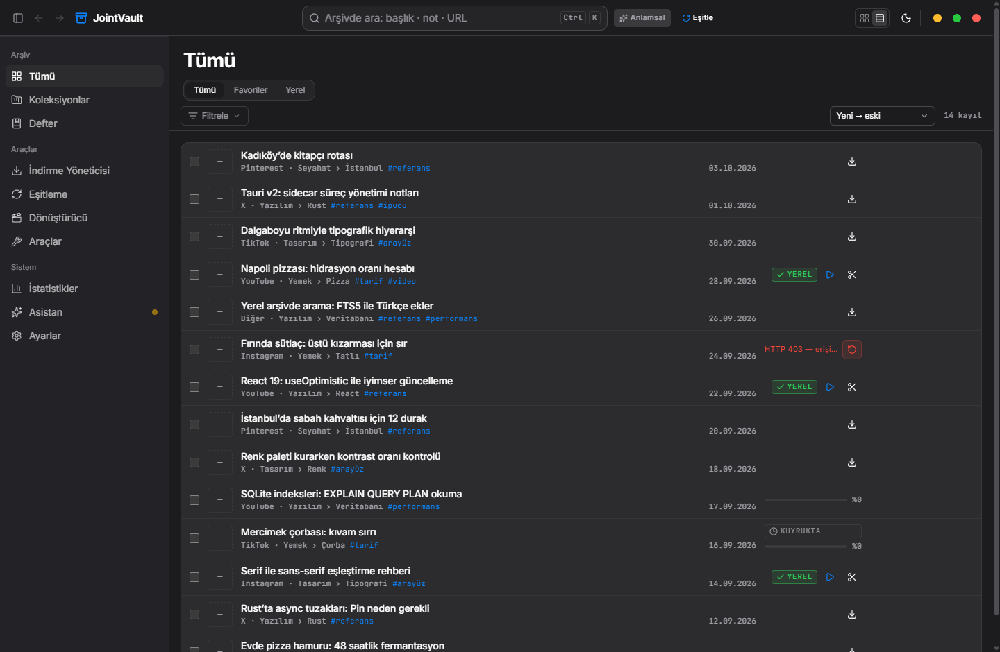
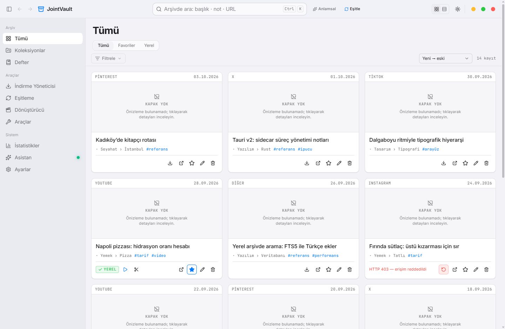
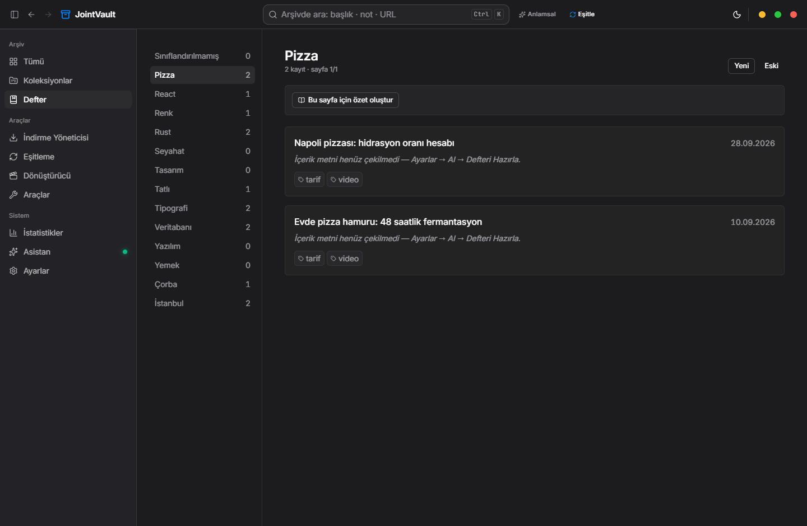
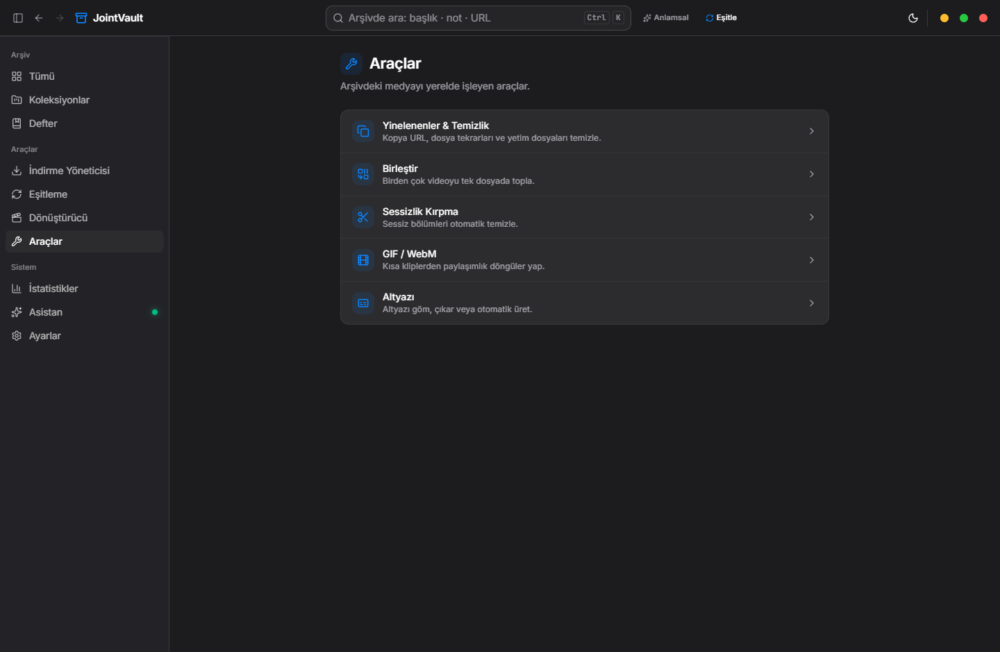
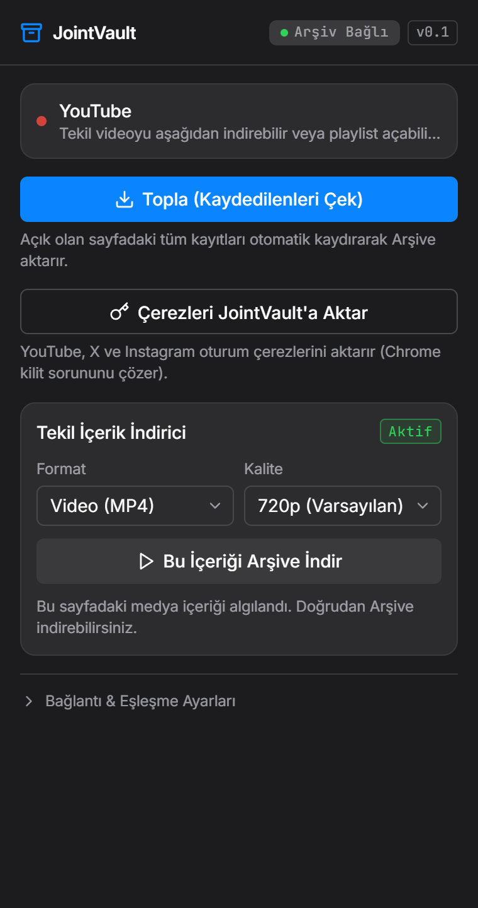
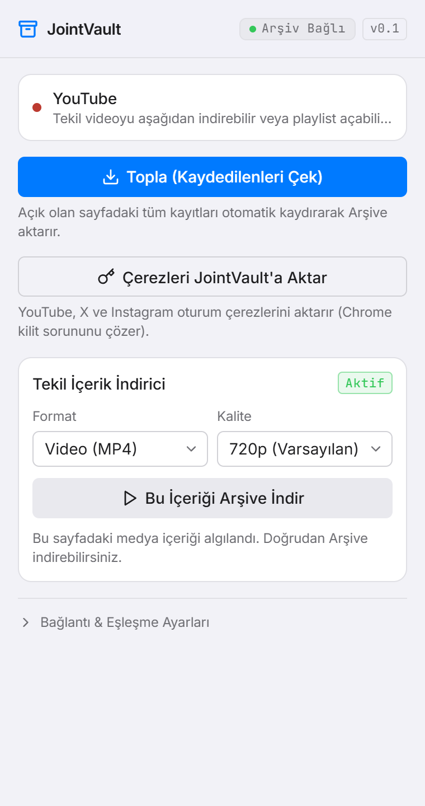

# JointVault

**Kişisel medya arşivi — tek yerel hat, bulut yok.**

X, Instagram, YouTube, TikTok ve Pinterest'te kaydettiğin post, video ve fotoğrafları
kaybetmeden tek yerde tut: linki kaydet, tarayıcı eklentisiyle topla, `yt-dlp` ile indir,
`ffmpeg` ile dönüştür/kırp, yinelenenleri ayıkla, kategori–etiket–koleksiyonla düzenle.
Kategori başına okunabilir bir **İçerik Defteri** derlenir: kayıtların metinleri,
görselleri ve linkleri defter sayfaları gibi tek yerde toplanır.

Hesap yok, kota yok, senkron yok. Dosya senin diskinde, kayıt senin veritabanında kalır.

> **Ekran görüntüleri gerçek uygulamadan alındı, içerik sentetik demo verisidir.**
> (Kişisel arşiv paylaşılmadı; arayüz gerçek, kayıtlar temsilî.)

<p align="center">
  
</p>

<details>
<summary><b>English summary</b></summary>

JointVault is a local-first personal media archive for Windows (Tauri v2 + React 19 +
SQLite). Save links one by one or in bulk, import from a browser extension (X bookmarks,
Instagram saved posts, YouTube playlists), download with a bundled `yt-dlp` sidecar,
convert/trim with `ffmpeg`, detect duplicates, and organise everything with hierarchical
categories, tags and collections. A per-category **content notebook** compiles the
archive into readable pages.

No cloud, no account, no telemetry: media lands on your disk, records in your SQLite
file. The UI is Turkish. The browser extension queues collections locally while the
desktop app is closed and syncs them through a token-protected localhost bridge when it
comes back. Design language and rules live in `DESIGN.md` / `PRODUCT.md`.

</details>

## Ne yapar

| Alan | Yetenek |
|---|---|
| **Arşiv** | Tekli/toplu link kaydı, kart & satır görünümü, kapsam sekmeleri (Tümü · Favoriler · Yerel), filtre paneli, tam metin arama, sayfalama (1000+ kayıt bütçesi) |
| **İçe aktarma** | Tarayıcı eklentisi: X yer imleri, Instagram kaydedilenler, YouTube oynatma listeleri (otomatik kaydırarak toplar) · pano izleyici · URL'den içe aktarma |
| **İndirme** | `yt-dlp` sidecar, gerçek format listesinden kalite seçimi, sıralı kuyruk, satır içi yüzde + hız/ETA, hata durumunda yeniden deneme |
| **Araçlar** | Medya dönüştürücü (mp4/mp3/m4a/kırp), zaman çizelgeli kırpma editörü (film şeridi + dalga formu), video birleştirme, sessizlik kırpma, GIF/WebM, altyazı gömme/çıkarma |
| **Defter** | Kategori hiyerarşisi (üst › alt), kategori başına sayfa, sayfa özeti, plan oluşturma ve taksonomi bakımı |
| **Yinelenenler** | URL kimliği + dosya hash'i ile gruplayıp birleştirme önerisi |
| **Asistan** | Yerel `llama.cpp` sidecar'ı ile semantik arama ve sohbet — tamamen çevrimdışı, modeller isteğe bağlı indirilir |
| **Kabuk** | Sistem tepsisi, tek örnek kilidi, `Ctrl+K` komut paleti, tema (koyu/açık/sistem), yedekleme & geri yükleme, tanılama paneli |

## Ekran görüntüleri

| Arşiv · koyu | Arşiv · açık (kartlar) |
|---|---|
|  |  |

| Defter (kategori sayfası) | Araçlar |
|---|---|
|  |  |

| Eklenti · koyu | Eklenti · açık |
|---|---|
|  |  |

## Mimari

Kaydetme, indirme ve dönüştürme **tek yerel hatta** bağlıdır:

```
tarayıcı eklentisi ──┐
pano izleyici ───────┤
URL'den içe aktarma ─┴──► eşleşme anahtarlı localhost köprüsü ──► SQLite arşivi
                            (127.0.0.1:48120)                        │
                                                                     ▼
                                        yt-dlp kuyruğu ──► ffmpeg / whisper araçları
```

- **Kabuk:** Tauri v2 (Rust) + React 19 + TypeScript + Vite + Tailwind v4 (`@theme`) +
  `@base-ui/react` + `lucide-react`. İstatistikler `recharts` ile (tembel yüklenir).
- **Veri:** `tauri-plugin-sql` üzerinden SQLite; şema göçleri `PRAGMA user_version` ile
  sürümlenir ve göç öncesi **zorunlu yedek** alınır.
- **Yan süreçler:** `yt-dlp` repoda (Git LFS); **ffmpeg/ffprobe repoda tutulmaz**
  (313 MB) — ilk kullanımda *Ayarlar → Bileşenler*'den sha256 doğrulamalı indirilir.
  Araçlar bileşen kaydından çözer: indirilen kopya varsa o, yoksa gömülü olan kullanılır.
- **Köprü:** `127.0.0.1:48120` üzerinde axum; uygulama kapalıyken eklenti topladıklarını
  yerel kuyruğa (outbox) yazar, uygulama açılınca tek partide aktarır.

Ayrıntılı geliştirici notları: [`jointvault/README.md`](jointvault/README.md) ·
Tasarım sözleşmesi: [`DESIGN.md`](DESIGN.md) · Ürün gerçeği ve dokunulmazlar:
[`PRODUCT.md`](PRODUCT.md)

## Kurulum (geliştirme)

Önkoşullar: **Node 20+**, **Rust stable**, Windows'ta WebView2 (Windows 11'de hazır gelir).

```powershell
cd jointvault
npm install
npx tauri dev        # arayüz + Rust backend birlikte
```

Doğrulama:

```powershell
cd jointvault
npm run check        # typecheck + lint + test (vitest)
cargo check --manifest-path src-tauri/Cargo.toml
npx tauri build      # MSI/NSIS: src-tauri/target/release/bundle/
```

## Tarayıcı eklentisi

`chrome://extensions` → **Geliştirici modu** → **Paketlenmemiş öğe yükle** →
`jointvault/extension` klasörünü seç. Ardından uygulamada *Ayarlar → Eklenti*
bölümündeki eşleşme anahtarını eklentiye yapıştır.

- **Topla:** açık sekmedeki X yer imlerini / Instagram kaydedilenleri / YouTube
  oynatma listesini sayfayı kaydırarak toplar ve arşive aktarır.
- **Uygulama kapalıyken:** parti `chrome.storage.local`'daki kuyruğa yazılır; uygulama
  açıldığında (≈1 dk içinde) tek partide aktarılır ve mevcut "Önizle ve onayla"
  akışına düşer. `401` ya da ağ hatasında kuyruk silinmez.
- **Çerez aktarımı:** Chrome açıkken dosya kilidini aşmak için oturum çerezlerini
  uygulamaya aktarır (`chrome.cookies` izni).

## Veri, gizlilik ve güvenlik

- **Bulut yok, telemetri yok.** Kayıtlar `jointvault.db` (uygulama veri dizini),
  medya *Ayarlar*'daki indirme klasöründe (varsayılan `Downloads/JointVault`) kalır.
- **Tek dış trafik:** senin istediğin medyayı çeken `yt-dlp`, bileşen (ffmpeg) ve
  isteğe bağlı yerel model indirmeleri.
- **Köprü sertleştirilmiştir:** yalnız `127.0.0.1`'e bağlanır; `Host` başlığı denetlenir
  (DNS rebinding), bir web sayfasından gelen istekler `Origin` ile reddedilir ve
  eşleşme anahtarı **sabit zamanlı** karşılaştırılır. Anahtar uygulama veri dizininde
  üretilir, depoya girmez.
- **CSP sıkıdır:** `default-src 'self'`, `object-src 'none'`, `frame-ancestors 'none'`
  (`jointvault/src-tauri/tauri.conf.json`).
- **Bilinen sınır:** eklenti eşleşme anahtarını `chrome.storage.local`'da düz metin
  tutar. Yerel bir köprü için kabul edilebilir; anahtar yalnızca bu makinede işe yarar.
- **`chrome.alarms`** tarayıcı kapalıyken çalışmaz; kuyruk aktarımı en geç tarayıcı
  açıkken bir dakika içinde gerçekleşir.

## Test

```powershell
cd jointvault
npm run check        # tsc + oxlint + vitest (29 dosya / 293 test)
```

Ayrıca `jointvault/dev/` altında gerçek çalışma zamanına karşı koşan kanıt betikleri
vardır (`verify-*.mjs`, `recapture-live.mjs`) — bunlar üretim kodu değildir.

## Lisans

[MIT](LICENSE) © 2026 Serhat Tomak
